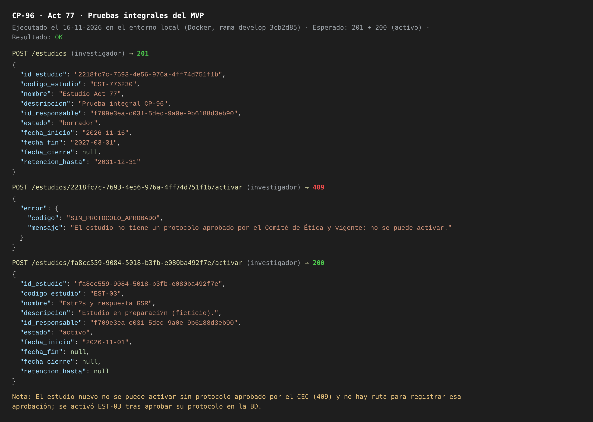
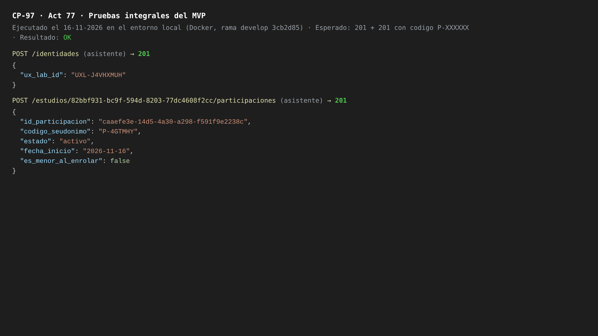
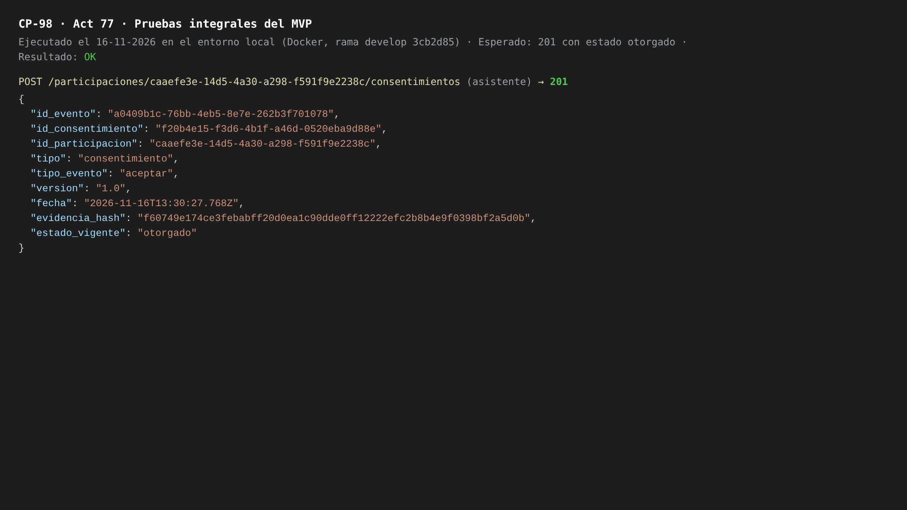
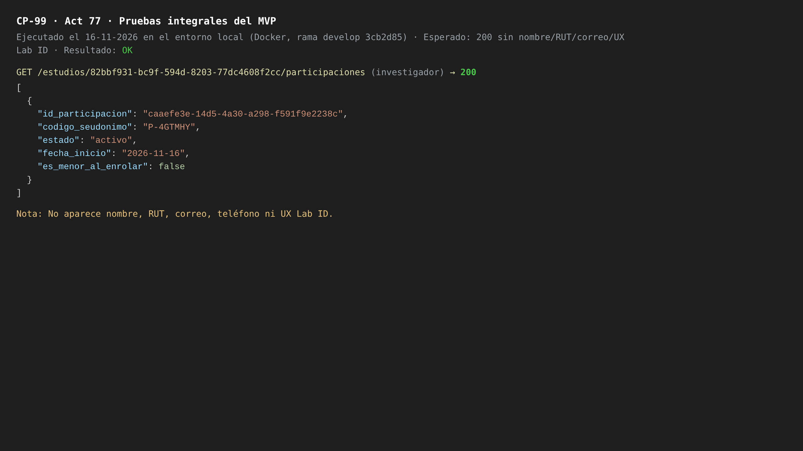
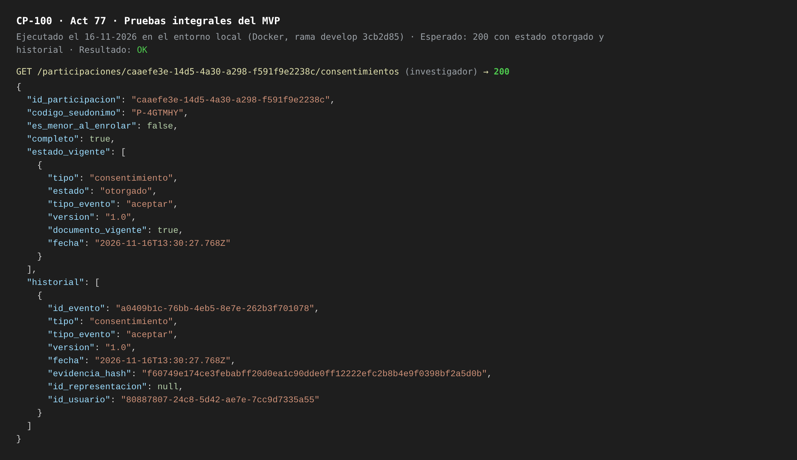

# Actividad 77 · Reporte de pruebas integrales del MVP
**Corte: 17 de noviembre de 2026 · Responsable del cierre: Felipe Cruz.**

## Resumen
Barrientos entregó cinco registros y cinco capturas individuales. Su resumen marca los cinco casos como OK según el CSV, con una intervención manual en CP-96. Arias reportó cuatro casos aprobados y dos parciales según el plan. No se suman como once casos del plan: los identificadores no siempre describen el mismo escenario. Este informe consolida ejecuciones del equipo; no se repitieron las pruebas.

## Casos de Barrientos (numeración del CSV)
| ID | Escenario ejecutado | Resultado observado |
|---|---|---|
| CP-96 | Crear y activar estudio | 201 al crear; 409 al activar sin aprobación. Se obtuvo 200 con EST-03 después de aprobar su protocolo directamente en la base. El flujo íntegro por API sigue parcial. |
| CP-97 | Registrar identidad y participación | 201 + 201; identidad y participación creadas. |
| CP-98 | Aceptar consentimiento con evidencia | 201; aceptación registrada. |
| CP-99 | Listar participaciones sin datos identificatorios | 200; el equipo reportó ausencia de nombre, RUT, correo, teléfono y UX Lab ID. |
| CP-100 | Consultar consentimiento e historial | 200; consulta con estado otorgado e historial. |

## Evidencias de Barrientos
### CP-96 · Crear y activar estudio

[Captura en Drive](https://drive.google.com/file/d/1KzpnmGTXvh4znMbJxmE7ak7DZUjm7MeR/view?usp=drivesdk) · [Registro JSON](https://drive.google.com/file/d/1O8kUm4HdDKCHhy-Pr8MyP4Wyq8H21SSH/view?usp=drivesdk)

### CP-97 · Registrar identidad y participación

[Captura en Drive](https://drive.google.com/file/d/1hF59XrFLyE5Z6wTygoFTbjZKH53f2Q_r/view?usp=drivesdk) · [Registro JSON](https://drive.google.com/file/d/1ztKkyM-9q4HI2iKrmvPcdXeiDIiHqC8k/view?usp=drivesdk)

### CP-98 · Aceptar consentimiento con evidencia

[Captura en Drive](https://drive.google.com/file/d/1fg_5DsasS98TiKI5Nh8BHBcIry8NcWCN/view?usp=drivesdk) · [Registro JSON](https://drive.google.com/file/d/1H3XHXRDsE81W9KKB9vIXWbJUCcwuTJ97/view?usp=drivesdk)

### CP-99 · Listar participaciones sin datos identificatorios

[Captura en Drive](https://drive.google.com/file/d/1kXRIumDPQ-GP912onVVXWIS0pX6HCEXM/view?usp=drivesdk) · [Registro JSON](https://drive.google.com/file/d/181hj82-7Bu1qcDYMI80_SqO0M2n3Scgi/view?usp=drivesdk)

### CP-100 · Consultar consentimiento e historial

[Captura en Drive](https://drive.google.com/file/d/1dBuyW3IxpXpoP3sUutrh6k5InyCRYl5E/view?usp=drivesdk) · [Registro JSON](https://drive.google.com/file/d/1Cy4YXxutdvXEaKZRs0IavCirb7WUOi0Q/view?usp=drivesdk)

## Casos de Arias (numeración del plan)
| Caso | Estado reportado | Resultado |
|---|---|---|
| CP-101 | Parcial | Inscripción correcta; falta evidencia del flujo inicial de documento y consentimiento. |
| CP-102 | Aprobado | Consentimiento 201; creación de estudio denegada al Asistente con 403. |
| CP-103 | Parcial | Retiro 201 y nuevo consentimiento bloqueado con 409. La carga devolvió 404 porque no existe la ruta. |
| CP-104 | Aprobado | La nueva versión exigió reconsentimiento; al aceptarla quedó otorgado con evidencia SHA-256. |
| CP-105 | Aprobado | Solicitud, aprobación y descarga ZIP; código E- y mes, sin códigos P- ni correos detectados. |
| CP-106 | Aprobado | La descarga posterior al retiro devolvió 409 EXPORTACION_DESACTUALIZADA. |
| CP-107 | Sin resultado en el informe revisado | Falta la revisión de privacidad de las respuestas para todos los roles. CP-99 cubre solo un listado. |

## Hallazgos y pendientes de cierre
- **Numeración:** el plan define CP-96 a CP-100 como asignar un investigador, primer ingreso con MFA, bloquear/desbloquear una cuenta, activar un estudio con aprobación CEC y verificar la cadena de auditoría. Las capturas de Barrientos siguen el CSV de Felipe. Su CP-96 aporta evidencia parcial al CP-99 del plan; las demás capturas no acreditan automáticamente los otros cuatro escenarios. Felipe debe conciliar por escenario antes del cierre.
- **CEC:** falta una ruta para registrar la aprobación. Conservar la intervención en base como condición de la prueba, no como éxito del flujo completo.
- **Carga tras retiro:** el 404 no verifica el bloqueo funcional esperado (409).
- **Integridad:** Arias reportó salida 1 de verificar-vinculos.js: tres participaciones activas sin consentimiento vigente y una exportación con retiro posterior (CP-106, descarga bloqueada). No se reportaron aceptaciones sin evidencia ni eventos sin auditoría. Falta acreditar el resultado de verificar-auditoria.js para el criterio del plan.
- **Cierre:** completar CP-101 y CP-107, conciliar casos y evidencias, y registrar con Felipe la severidad y el destino de los hallazgos. La recopilación documental no acredita el cierre integral.

## Fuentes
[Plan v1.1](https://drive.google.com/file/d/1fGNQp1xPDeYWlVKtEr9VH60fcl0nWpRs/view) · [Evidencias originales de Barrientos](https://drive.google.com/drive/folders/1pupWS9yJsP8zk1t8DPYU4p0BHL2gqcrt) · [CSV de Felipe](https://github.com/PlaGesEtic-Utem/PlaGesEtic/blob/8c48b13/docs/pruebas/act77_casos_prueba.csv) · [Resultados de Arias](https://github.com/PlaGesEtic-Utem/PlaGesEtic/blob/8c48b13/backend/docs/pruebas/act77_resultados_arias.md).
